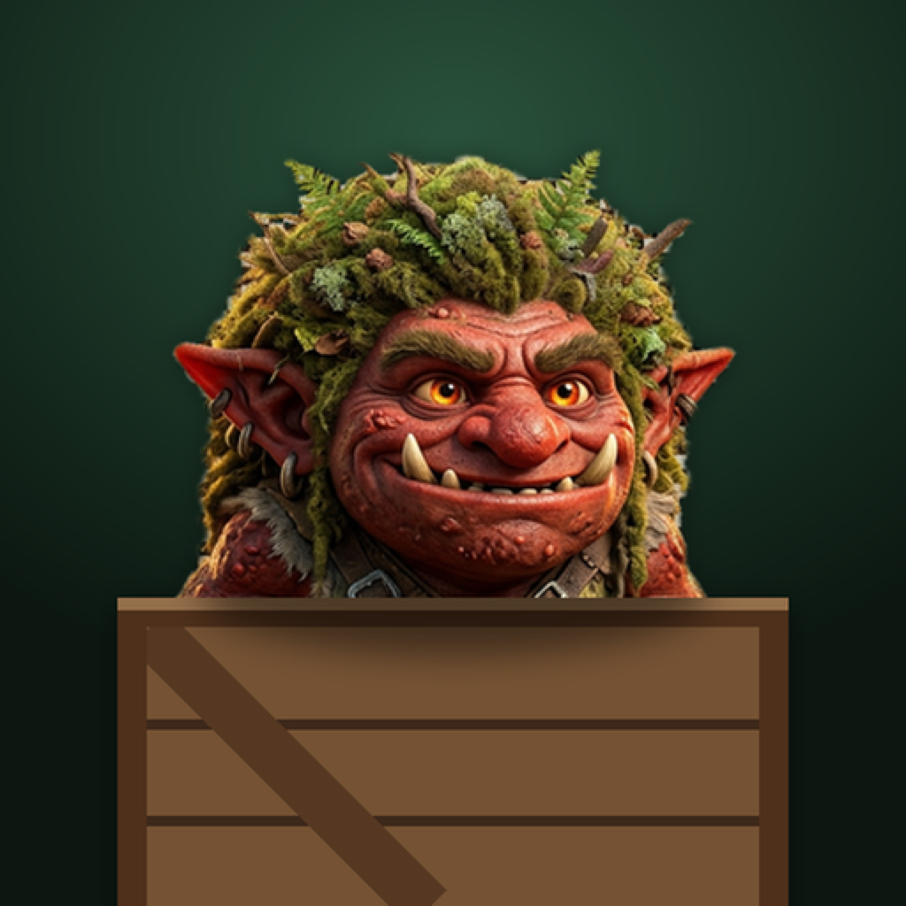

#  Tic Tac Troll for iOS

*A game of mild contempt.* Tic-tac-toe for iPhone and iPad, played with trolls who look each other over, grumble "meh" and "bleh", and topple off their crates into the dirt, then pop, when they lose. A SwiftUI port of [Tic Tac Troll for Android](https://github.com/nbradbury/tictactroll-android).


https://github.com/user-attachments/assets/dd26e2d7-d9fb-4cca-8798-4104240e3469


## Features

- **Play the CPU or a friend.** Three CPU skill levels: Easy (random), Medium (wins or blocks when it can, mostly), and Troll (minimax; never loses in classic games). Two-player mode is pass-and-play.
- **Bored trolls mode.** Each player keeps at most three trolls. Play a fourth and your oldest gets bored and pops like a bubble, unless that fourth completes a row with it, which still wins. Games can't end in a draw. The troll about to leave is dimmed, and the setting is remembered.
- **Trolls with attitude.** They drop onto their crates with a squash, breathe, blink, look around at each other, startle when a neighbor lands, and grumble every few seconds. Block a winning line and the blocking troll says "bleh". The troll about to get bored yawns, and Bramble's trolls look up and ponder while the CPU thinks. Losers glance at the winning line before they topple into the dirt and pop, the three in the winning line hop while their teammates look down at them, and a draw gets a slow, disapproving blink, a collective stare and a "meh" from everyone.
- **Sound.** Background music, a thunk as each troll lands, and an ending sound for every outcome: a fanfare for a win, a sad trombone for losing to the CPU, and a brass shrug for a tie. A toggle on the menu mutes everything, and the setting is remembered. Sound follows the silent switch.
- **Feel.** Haptic ticks as trolls land, a ghost preview while you hold a finger on a crate, and Bramble has opinions about the difficulty you pick.
- **Full screen, any screen.** The status bar and home indicator are hidden. iPhones play in portrait; iPads can rotate, and wide windows lay the game out side by side.
- **Accessible.** Works with VoiceOver: every crate is labeled and moves (including the CPU's) are announced.
- **Rematches alternate** who goes first; Restart keeps the same starter.

## Building

Requires Xcode 16 or later. The app runs on iOS 17 and up, with no third-party dependencies.

```sh
open TicTacTroll.xcodeproj   # then run the TicTacTroll scheme
xcodebuild -project TicTacTroll.xcodeproj -scheme TicTacTroll \
  -destination 'platform=iOS Simulator,name=iPhone 17' test   # includes an exhaustive check that Troll mode never loses a classic game
```

## Project layout

```
TicTacTroll/
  App/TicTacTrollApp.swift  entry point, saved settings, screen switching, sound and haptics wiring
  Game/GameLogic.swift      board, rules (classic and bored trolls), win detection, CPU move selection
  Game/GameModel.swift      game state, turns, and the timers behind glances, chatter, yawns and endings
  UI/MenuView.swift         title, settings panel (mode, difficulty, Bored trolls), sound toggle
  UI/GameView.swift         scores, board, falls and pops, result sheet
  UI/TrollView.swift        the animated troll (landing, blinking, moods, reactions) and its speech bubble
  UI/TrollArt.swift         draws the troll art with movable irises and eyelids
  UI/Crate.swift            the wooden crate each cell is drawn as
  UI/Components.swift       shared pieces: backdrop, title, chunky button, Compose-style springs
  UI/Adaptive.swift         scales the layout to the window and picks side by side for wide windows
  UI/GameSounds.swift       sound effects and troll voices
  UI/GameHaptics.swift      haptic feedback for landings and endings
  UI/BackgroundMusic.swift  looping music while the app is active
  UI/Theme.swift            colors and fonts
  Resources/                fonts, sounds and music
TicTacTrollTests/           game logic tests
```

## Credits

- Game design prototyped in Claude Design.
- Troll images created by Adobe Firefly.
- Background music: *Where the Trolls Tread* created by Google Gemini.
- Sound effects and troll voices are synthesized.
- Fonts: [Lilita One](https://fonts.google.com/specimen/Lilita+One), [Rubik Dirt](https://fonts.google.com/specimen/Rubik+Dirt), [DM Sans](https://fonts.google.com/specimen/DM+Sans) and [JetBrains Mono](https://fonts.google.com/specimen/JetBrains+Mono), all under the SIL Open Font License 1.1.

By Nick Bradbury.
